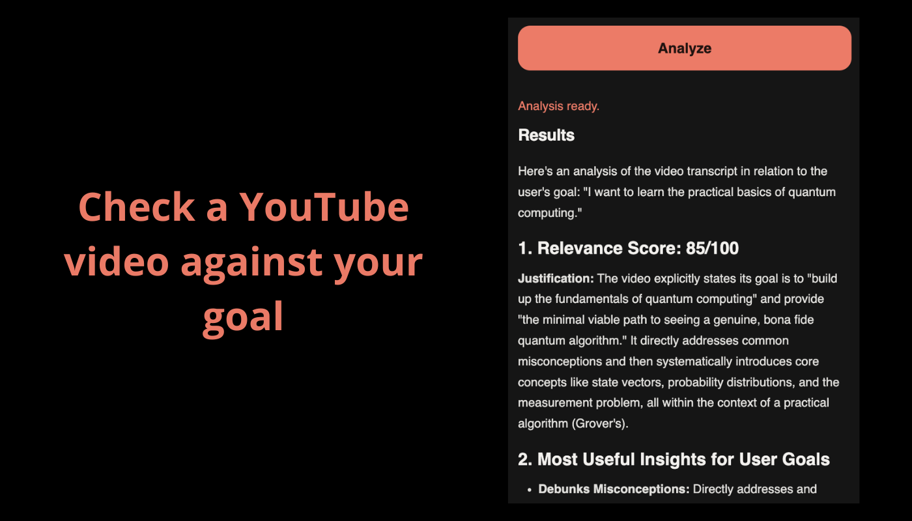
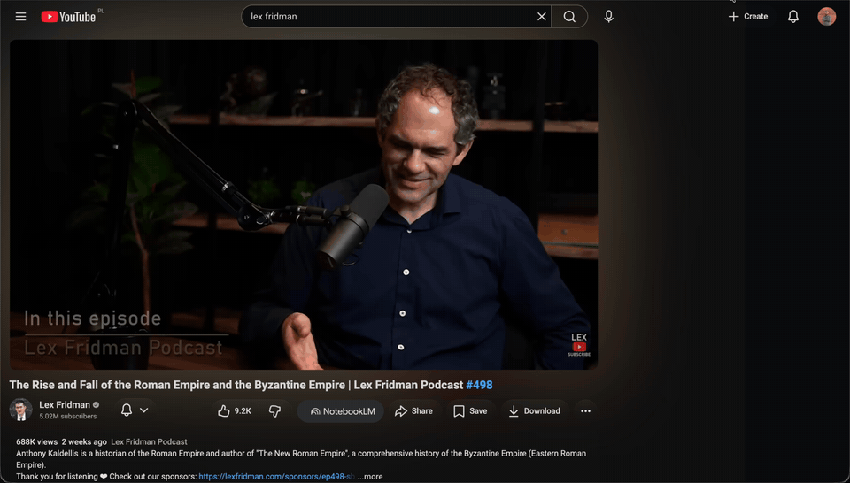

# SmartWatch





**Available on the Chrome Web Store: [SmartWatch](https://chromewebstore.google.com/detail/smartwatch/fopiegopbjbnjkdddkebeopmjmkclbda)**

SmartWatch analyzes YouTube videos against your goals. When you click `Analyze`, it reads accessible transcript or caption data from the current YouTube watch page and sends the transcript plus your goal to Google Gemini using your API key.

I use this extension myself, so the project is still evolving in practical ways.
For the time being, I may continue updating transcript fallbacks, fixing errors, and improving reliability as YouTube and model behavior change.

## Requirements

- Google Chrome with Manifest V3 support
- Gemini API key from Google AI Studio

## Installation

Use the published extension from the [Chrome Web Store](https://chromewebstore.google.com/detail/smartwatch/fopiegopbjbnjkdddkebeopmjmkclbda), or load this repository locally:

1. Open `chrome://extensions`.
2. Enable `Developer mode`.
3. Click `Load unpacked`.
4. Select the project folder.

More details: [Chrome Extensions Documentation](https://developer.chrome.com/docs/extensions)

## Usage

1. Open a YouTube watch page.
2. Open the SmartWatch side panel from the extension action.
3. Open `Settings`.
4. Paste your `Gemini API Key` and click `Save settings`.
5. Optionally open `Advanced`, pick a Gemini model preset, or choose `Custom` and enter a model string manually.
6. Enter or edit your goal in the main view.
7. Click `Analyze`.
8. Read the result in `Results`.

## Why Gemini

This project uses Gemini for a few practical reasons:

- it is accessible for students through Google AI Studio and often comes with a generous free tier,
- it is easy to test and iterate with using a personal API key,
- in practice, it has felt particularly good at summarizing long YouTube transcripts and turning them into structured takeaways.

## Testing

Run the native Node.js test runner:

```bash
npm test
```

## Documentation

- [Technical notes](docs/TECHNICAL.md): architecture, analysis flow, advanced settings, limitations, and changelog.
- [Legal and safety notes](docs/LEGAL.md): data handling, permissions, disclaimer, and acceptable use.
- [Privacy policy](PRIVACY.md): repository privacy policy.

## Support

For support, questions, or policy/contact context, use the developer profile at [linkedin.com/in/piotr-obiegly](https://www.linkedin.com/in/piotr-obiegly).
