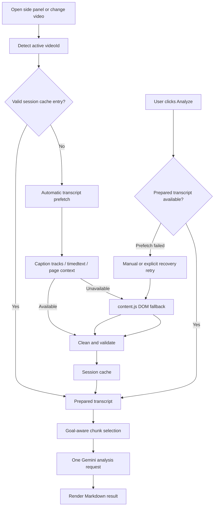

# SmartWatch Technical Notes

## Architecture Overview

| File | Function |
| --- | --- |
| `manifest.json` | Declares permissions, extension entry points, side panel, content script, and background service worker. |
| `background.js` | Enables the side panel on YouTube watch pages and keeps that state synchronized across startup, navigation, and tab activation. |
| `content.js` | Reads the active YouTube video context and performs DOM-based transcript extraction as the final fallback. |
| `errors.js` | Defines shared application error types used across transcript processing and Gemini calls. |
| `sidepanel.html` | Defines the side panel UI structure for goals, results, settings, and advanced options. |
| `sidepanel.js` | Manages UI state, transcript prefetch, saved settings, analyze flow, status messages, and Markdown rendering. |
| `styles.css` | Defines the visual system and layout for the side panel. |
| `transcript.js` | Retrieves transcripts through caption tracks first, then timedtext fallback, then page-context fallback logic. |
| `transcript-processing.js` | Cleans, deduplicates, validates, and chunks transcript text independently of user goals. |
| `transcript-cache.js` | Stores prepared transcripts in `chrome.storage.session`, enforces TTL/entry limits, and deduplicates concurrent fetches. |
| `transcript-workflow.js` | Coordinates automatic prefetch with explicit-analysis recovery when a previous attempt failed. |
| `gemini.js` | Builds the final prompt, calls Gemini, and maps API errors into shorter user-facing messages. |
| `PRIVACY.md` | Documents the current privacy policy, data handling, and permission usage of the repository. |

## Analysis Flow

1. When the side panel opens, `sidepanel.js` detects the current YouTube video and immediately starts transcript prefetch.
2. `transcript.js` first tries caption tracks, timedtext, and page-context retrieval.
3. If those methods fail, prefetch uses the DOM fallback, which may expand the video description and open YouTube's transcript panel.
4. `transcript-processing.js` cleans and validates the result before it is stored in the session cache.
5. `transcript-cache.js` reuses a valid entry for the same `videoId`, deduplicates concurrent requests, and removes expired or excess entries.
6. When YouTube SPA navigation changes the active video, `background.js` notifies the open side panel and prefetch starts for the new `videoId`.
7. User enters a goal and clicks `Analyze`.
8. If automatic prefetch failed, the user can retry it from the error state; explicit analysis also retries transcript retrieval once more.
9. If the transcript is too long, `gemini.js` selects chunks relevant to the current goal.
10. Transcript + goal are sent to Gemini in one analysis request (`gemini.js`).
11. Gemini response is rendered as Markdown in the side panel.

## System Flow



## Transcript Prefetch and Session Cache

Transcript preparation is goal-independent and starts only while the side panel is open. Prefetch does not call Gemini. It first tries non-interactive caption sources and, when necessary, automatically uses the DOM fallback; this may expand the video description and open YouTube's transcript panel. Gemini is still called only after the user explicitly clicks `Analyze`.

Prepared transcripts are stored under versioned keys such as `smartwatch:transcript:v1:{videoId}` in `chrome.storage.session` with:

- a one-hour TTL,
- a maximum of five newest transcript records,
- automatic removal of expired and excess records,
- in-memory deduplication when multiple callers request the same video concurrently,
- no caching of failed retrieval or validation attempts.

Session storage allows reuse after closing and reopening the side panel during the same browser session, but it does not persist transcripts across browser restarts. If session storage is temporarily unavailable, the fetched transcript can still be analyzed; it is simply not reused later.

Cleaning, noise removal, deduplication, and quality validation run before caching. Selection of relevant long-transcript chunks remains goal-dependent and runs only after `Analyze` because changing the goal may change which chunks are most useful.

## Advanced Settings

Advanced Settings let you:

- choose a model preset or enter a custom Gemini model string,
- define a custom prompt template for the final analysis.

The custom prompt template supports these placeholders:

- `${goals}`
- `${transcript}`

Custom prompt templates are validated before saving and before analysis.

Current safeguards:

- both `${goals}` and `${transcript}` are required,
- very short templates are rejected,
- templates with too little instruction text beyond the placeholders are rejected.

For long videos, SmartWatch also compacts the transcript before sending it to Gemini by selecting the most relevant transcript chunks and keeping the prompt within a safer size budget.
SmartWatch also requests a larger Gemini output budget, applies conservative Gemini 2.5 thinking budgets where supported, and retries once with a tighter completion prompt if Gemini stops because the response hit its output limit.

Current default prompt template:

```text
You are analyzing a YouTube video transcript in relation to user goals.

User goals:
${goals}

Video transcript:
${transcript}

Explain:
1. Relevance score (0-100) and short justification
2. Most useful insights for the user goals
3. Actionable next steps
4. Risks, caveats, or blind spots

Keep the answer concise but complete. Use clear section headings.
```

## Limitations

Known limitations and failure modes:

- Videos without accessible captions or transcript data will fail analysis.
- Some videos may expose caption metadata but still return empty or unusable transcript payloads.
- YouTube markup changes can break the DOM extraction fallback in `content.js`.
- Changes to YouTube caption endpoints can break track-based or timedtext-based transcript retrieval.
- Non-watch YouTube pages are unsupported. The extension only analyzes `https://www.youtube.com/watch?...` pages.
- Invalid Gemini API keys return an authentication error and analysis will not start.
- Gemini quota exhaustion or rate limiting will block analysis until quota is available again.
- Custom model strings may fail if the selected model name is unavailable or unsupported by the API.
- Custom prompt templates can reduce output quality if placeholders are omitted or instructions are too vague.
- The extension currently prefers English tracks before other available languages, which may not match the spoken language of the video.
- Very short, noisy, or auto-generated transcript fragments may be rejected as unusable content.
- Automatic prefetch may visibly expand the description and open YouTube's transcript panel when caption endpoints do not return usable text.
- Session cache entries expire after one hour and are cleared with the browser session, so a transcript may need to be fetched again later.

## Changelog

### Unreleased

- Made the DOM fallback resilient to newer YouTube layouts by expanding the video description, recognizing localized transcript controls such as `Wyświetl transkrypcję`, and reading modern `transcript-segment-view-model` rows as well as legacy transcript renderers.
- Replaced fixed DOM polling with mutation-aware waiting and clarified the prefetch retry status shown before explicit analysis.
- Added a manual `Retry transcript` action that appears only after prefetch fails.
- Enabled full transcript prefetch, including the DOM fallback, when the side panel opens and when the active YouTube video changes.
- Added versioned browser-session transcript caching with a one-hour TTL, a five-entry limit, and concurrent request deduplication.
- Kept Gemini calls behind the explicit `Analyze` action while allowing transcript preparation to finish beforehand.
- Split transcript processing, caching, and workflow coordination into independently testable modules.
- Added a reproducible packaging command that tests the project, creates a minimal versioned ZIP, and verifies its contents.
- Reduced cut-off analysis results on longer videos by increasing the Gemini output budget.
- Added Gemini 2.5 thinking-budget configuration so more of the response budget is available for the visible analysis.
- Added a one-time retry with a stricter completion prompt when Gemini reports `MAX_TOKENS`.
- Added a user-facing error if the analysis still exceeds the output limit after retrying.
