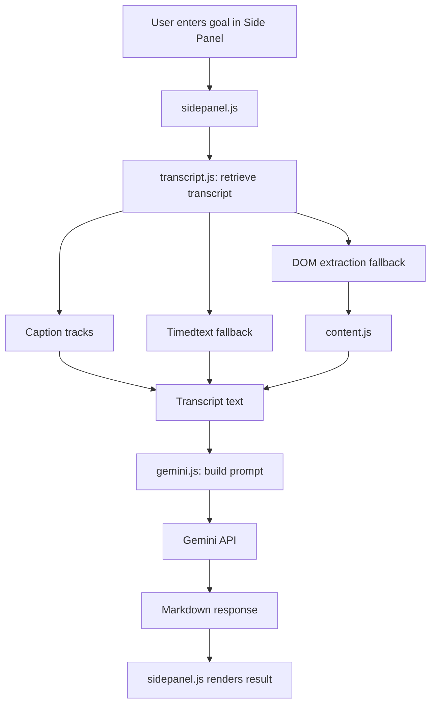

# SmartWatch Technical Notes

## Architecture Overview

| File | Function |
| --- | --- |
| `manifest.json` | Declares permissions, extension entry points, side panel, content script, and background service worker. |
| `background.js` | Enables the side panel on YouTube watch pages and keeps that state synchronized across startup, navigation, and tab activation. |
| `content.js` | Reads the active YouTube video context and performs DOM-based transcript extraction as the final fallback. |
| `sidepanel.html` | Defines the side panel UI structure for goals, results, settings, and advanced options. |
| `sidepanel.js` | Manages UI state, saved settings, analyze flow, validation, status messages, and Markdown rendering. |
| `styles.css` | Defines the visual system and layout for the side panel. |
| `transcript.js` | Retrieves transcripts through caption tracks first, then timedtext fallback, then page-context fallback logic. |
| `gemini.js` | Builds the final prompt, calls Gemini, and maps API errors into shorter user-facing messages. |
| `PRIVACY.md` | Documents the current privacy policy, data handling, and permission usage of the repository. |

## Analysis Flow

1. User enters a goal in the side panel.
2. `sidepanel.js` detects the current YouTube video.
3. `transcript.js` tries caption tracks first.
4. If needed, `transcript.js` tries the timedtext fallback.
5. If needed, DOM extraction fallback is used through `content.js`.
6. If the transcript is too long, `gemini.js` compacts it before sending it to the model.
7. Transcript + goal are sent to Gemini (`gemini.js`).
8. Gemini response is rendered as Markdown in the side panel.

## System Flow



## Advanced Settings

Advanced Settings let you:

- choose a model preset or enter a custom Gemini model string,
- define a custom prompt template for the final analysis.

The custom prompt template supports these placeholders:

- `${goals}`
- `${transcript}`

Custom prompt templates are validated before saving and before analysis.

Current safeguards:

- both `${goals}` and `${transcript}` are required,
- very short templates are rejected,
- templates with too little instruction text beyond the placeholders are rejected.

For long videos, SmartWatch also compacts the transcript before sending it to Gemini by selecting the most relevant transcript chunks and keeping the prompt within a safer size budget.
SmartWatch also requests a larger Gemini output budget, applies conservative Gemini 2.5 thinking budgets where supported, and retries once with a tighter completion prompt if Gemini stops because the response hit its output limit.

Current default prompt template:

```text
You are analyzing a YouTube video transcript in relation to user goals.

User goals:
${goals}

Video transcript:
${transcript}

Explain:
1. Relevance score (0-100) and short justification
2. Most useful insights for the user goals
3. Actionable next steps
4. Risks, caveats, or blind spots

Keep the answer concise but complete. Use clear section headings.
```

## Limitations

Known limitations and failure modes:

- Videos without accessible captions or transcript data will fail analysis.
- Some videos may expose caption metadata but still return empty or unusable transcript payloads.
- YouTube markup changes can break the DOM extraction fallback in `content.js`.
- Changes to YouTube caption endpoints can break track-based or timedtext-based transcript retrieval.
- Non-watch YouTube pages are unsupported. The extension only analyzes `https://www.youtube.com/watch?...` pages.
- Invalid Gemini API keys return an authentication error and analysis will not start.
- Gemini quota exhaustion or rate limiting will block analysis until quota is available again.
- Custom model strings may fail if the selected model name is unavailable or unsupported by the API.
- Custom prompt templates can reduce output quality if placeholders are omitted or instructions are too vague.
- The extension currently prefers English tracks before other available languages, which may not match the spoken language of the video.
- Very short, noisy, or auto-generated transcript fragments may be rejected as unusable content.

## Changelog

### Unreleased

- Reduced cut-off analysis results on longer videos by increasing the Gemini output budget.
- Added Gemini 2.5 thinking-budget configuration so more of the response budget is available for the visible analysis.
- Added a one-time retry with a stricter completion prompt when Gemini reports `MAX_TOKENS`.
- Added a user-facing error if the analysis still exceeds the output limit after retrying.
